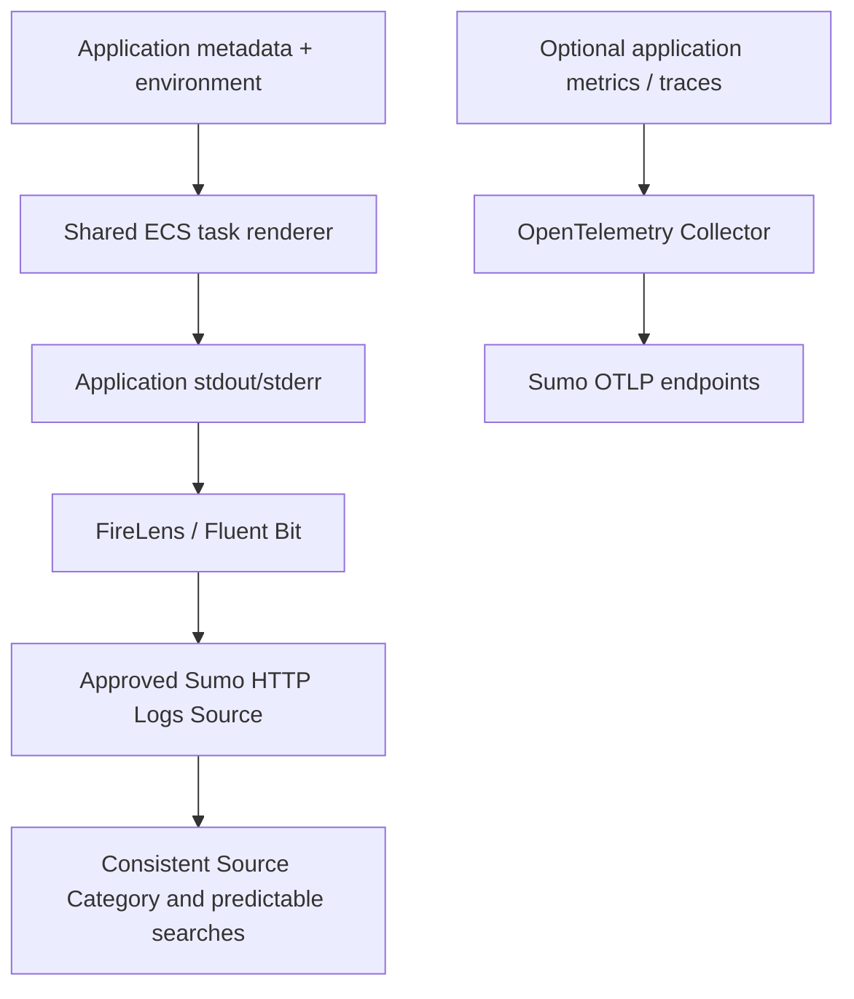

# ECS logging standards lab: FireLens + Sumo Logic

Different applications provide different metadata, but use the same logging implementation.
This small ECS/Fargate lab keeps the original Pokemon worker, Flask API, and optional
OpenTelemetry example. It demonstrates a reusable logging pattern, not a production framework.

## Problem and solution

When applications, environments, and teams independently copy task definitions and invent
Collectors, HTTP Sources, and Source Categories, configurations drift. Searches become hard
to discover and Field Extraction Rules become difficult to scope.

Use centrally managed ingestion resources, one ECS/FireLens implementation, hierarchical
categories, structured application logs, infrastructure-as-code, and deployment-time validation.



Application teams own `application`, `component`, `image`, version, ports, CPU/memory,
and business-specific environment variables. The deployment selects `environment`.
Shared platform code owns Collector/Source mapping, FireLens, endpoint handling, TLS,
category construction, ECS metadata, and validation. Logs work without enabling OTel.

## Collector, Source, and category are different things

| Concept | This lab | What it controls |
| --- | --- | --- |
| Hosted Collector | `ecs-sandbox`, `ecs-prod` | A stable ingestion boundary, reused across applications and deployments |
| HTTP Logs Source | `ecs-application-logs` under each Collector | The HTTPS endpoint that actually receives logs |
| Source Category | `ecs/<environment>/<application>/<component>` | Searchable metadata sent in `X-Sumo-Category` |

A Collector can have multiple Sources. Customers may organize Collectors by account,
ownership, security requirements, or other boundaries instead of just environment.
Neither ECS nor FireLens creates a Collector. `X-Sumo-Category` overrides the Source's
default category; **it does not select or create a Collector or HTTP Source**. The HTTP
Source URL determines the destination. See [Sumo's HTTP headers documentation](https://www.sumologic.com/help/docs/send-data/hosted-collectors/http-source/logs-metrics/upload-logs/).

The examples model two distinct applications as separate tasks, each with the same router:

| Application | Component | Environment | Generated category | Collector / Source |
| --- | --- | --- | --- | --- |
| pokemon-pinger | worker | sandbox | `ecs/sandbox/pokemon-pinger/worker` | ecs-sandbox / ecs-application-logs |
| pokemon-pinger | worker | prod | `ecs/prod/pokemon-pinger/worker` | ecs-prod / ecs-application-logs |
| pokemon-catcher | api | sandbox | `ecs/sandbox/pokemon-catcher/api` | ecs-sandbox / ecs-application-logs |
| pokemon-catcher | api | prod | `ecs/prod/pokemon-catcher/api` | ecs-prod / ecs-application-logs |

The pinger still fetches Pokemon from PokeAPI; the catcher still serves `/catch/<id>`
and emits heartbeats. They do not need to call each other for this example.

## Start locally: render all four combinations

Python 3.10+ is sufficient for rendering; no Python dependencies or cloud credentials are
needed. Commands below use Bash. The checked-in hostnames, ARNs, and image names are
illustrative placeholders, **not deployable resource references**.

```bash
for app in pokemon-pinger pokemon-catcher; do
  for env in sandbox prod; do
    python ecs/render_task.py --app "ecs/examples/$app.json" \
      --environment "$env" --platform ecs/platform.example.json \
      --destinations ecs/destinations.example.json \
      --output "build/$app-$env.json"
  done
done
```

Inspect the four JSON files in ignored `build/`. Only the image, resources, application
environment, category, and environment-specific destination/diagnostics vary. There is
one implementation of `awsfirelens`, the HTTP output, and the router in
[`ecs/render_task.py`](ecs/render_task.py). Do not edit generated logging blocks.

The renderer rejects missing metadata, unknown environments, arbitrary logging overrides,
invalid category segments, reserved identity variables, unsafe ports, and incompatible
task resources. This lab supports the small Fargate task sizes from 0.25 through 4 vCPU.

## Create shared ingestion infrastructure

[`terraform/sumologic/main.tf`](terraform/sumologic/main.tf) is reference infrastructure.
For each environment it creates a Hosted Collector, one HTTP Logs Source configured for
JSON lines, and an AWS Secrets Manager secret containing only the token-bearing URI path.
It does not provision ECS clusters, IAM roles, networks, or services.

Prerequisites: Terraform 1.7+, a Sumo account, an AWS account, and credentials permitted
to manage these resources. Supply `SUMOLOGIC_ACCESSID` and `SUMOLOGIC_ACCESSKEY` through
your shell/CI secret store. Use the normal AWS credential chain, such as an authenticated
`AWS_PROFILE`. Do not put credentials in `.tfvars`. The Sumo API deployment (such as `us2`)
is distinct from the application's environment (such as `prod`).

```bash
cp terraform/sumologic/terraform.tfvars.example terraform/sumologic/terraform.tfvars
# Edit sumo_deployment and aws_region. Supply credentials outside this repository.
terraform -chdir=terraform/sumologic init
terraform -chdir=terraform/sumologic plan
terraform -chdir=terraform/sumologic apply
mkdir -p build
terraform -chdir=terraform/sumologic output -json destinations > build/destinations.json
```

The exported mapping contains **only the hostname and secret ARN** for each environment.
The shared renderer puts the hostname in `Host` and the ARN in `secretOptions.URI`.
ECS resolves the secret at task startup. Both sandbox applications use the sandbox Source;
both prod applications use the prod Source. The header then identifies the application/component.

The sensitive `source_urls` output is available for other deployment tooling. Full URLs
and tokens are stored in Terraform state even when outputs are marked sensitive. Keep
state, plans, and URLs out of Git and CI logs; use an access-controlled encrypted backend
for shared use. Do not dump `terraform output -json` without selecting `destinations`.
The defaults use local state for a disposable lab.

For existing resources, import the Collectors/Sources into this Terraform state before
applying, or have your existing IaC publish the same hostname/secret-ARN mapping. No manual
Sumo UI creation is required for application onboarding. Import syntax is documented by
the [Collector](https://registry.terraform.io/providers/SumoLogic/sumologic/latest/docs/resources/collector)
and [HTTP Source](https://registry.terraform.io/providers/SumoLogic/sumologic/latest/docs/resources/http_source) resources.
This example uses URL-token HTTP Sources; auth-header Sources would need a corresponding
shared output change. After token rotation, update the secret and launch fresh tasks.

## Prepare and register an ECS task

1. Build from the repository root and push both images to your registry:

   ```bash
   docker build -f app/Dockerfile -t pokemon-pinger:lab .
   docker build -f app2/Dockerfile -t pokemon-catcher:lab .
   ```

2. Copy the application and platform examples to ignored `*.local.json` files. Set
   deployable image references, AWS region, each environment's execution role, and an
   existing CloudWatch log group. Use release tags or digests for repeatability. The lab
   router image uses the AWS for Fluent Bit `3` major tag; pin it when adopting the pattern.

3. Give the **task execution role** image-pull permissions, `logs:CreateLogStream` /
   `logs:PutLogEvents` on its diagnostics group, and `secretsmanager:GetSecretValue` on
   its environment's URI secret. A customer-managed KMS key also needs `kms:Decrypt`.
   Pre-create the log group; the renderer does not grant `logs:CreateLogGroup`.
   The applications do not call AWS APIs, so a task role is optional; platform settings
   accept `task_role_arn` if an application later needs one.

4. Render against the real, approved mapping, then register:

   ```bash
   python ecs/render_task.py --app ecs/examples/pokemon-catcher.local.json \
     --environment sandbox --platform ecs/platform.local.json \
     --destinations build/destinations.json --output build/catcher-sandbox.json
   aws ecs register-task-definition --cli-input-json file://build/catcher-sandbox.json \
     --region us-east-1
   ```

5. Use that task revision in your existing ECS service or `run-task` workflow with Linux
   Fargate platform 1.4.0 or later. Provide subnets/security groups, image and Secrets
   Manager access, and HTTPS egress to Sumo (and PokeAPI for the pinger). Allow the catcher's
   port 8080 only to intended clients. **Do not allow inbound port 24224** to the task.

Infrastructure diagnostics from the router/OTel Collector go to CloudWatch, avoiding a
self-referential log path. Application logs go to Sumo through FireLens.

## Onboard another application

Copy one small application JSON file and set its name, component, image, version,
ports, CPU/memory, and business environment variables. Choose an already approved
environment and run the same renderer in CI. For example, `connection-hub` / `api` in
`sandbox` automatically becomes `ecs/sandbox/connection-hub/api`. There is no category
string, Collector name, endpoint, TLS setting, or Fluent Bit configuration for developers
to invent. Add a test case for the new application and deploy the generated task.

## FireLens changes from the original example

- Removed the hand-maintained `task-definition.json`: it duplicated output blocks,
  contained unquoted placeholders, and included ECS response-only fields.
- Removed `config-file-type: s3`. Fargate supports `file` directly, not `s3`. This lab
  needs no custom filter, so ECS generates the entire Fluent Bit configuration. If an
  approved profile later needs a custom filter, bake it into the router image at a path
  such as `/extra.conf` and use `config-file-type: file`. Do not replace the reserved
  `/fluent-bit/etc/fluent-bit.conf` or add another forward input. AWS also offers an init
  approach for loading S3 configuration. [AWS custom configuration guidance](https://docs.aws.amazon.com/AmazonECS/latest/developerguide/firelens-taskdef.html)
- Removed application `Match: *`; ECS supplies per-container matching. The generated
  output uses HTTPS/443, certificate verification, JSON lines, and a derived category.
- Kept `enable-ecs-log-metadata: true`. ECS supplies cluster, task ARN, and task definition
  metadata; the envelope also carries container identity and stdout/stderr source.
  [AWS FireLens metadata and networking](https://docs.aws.amazon.com/AmazonECS/latest/developerguide/using_firelens.html)
- Moved sensitive ingestion paths into ECS `secretOptions`, backed by Secrets Manager.
  [AWS secret injection](https://docs.aws.amazon.com/AmazonECS/latest/developerguide/specifying-sensitive-data.html)

## Log payloads, searches, and governance

Applications emit the shared `json-v1` profile, including `timestamp`, `level`, `message`,
`service`, `environment`, and `version`, plus business fields. FireLens wraps this in an
ECS envelope; it does not automatically promote the application's JSON fields.
See [the logging standard](docs/ecs-logging-standard.md) for payload examples, extraction,
and governance responsibilities.

```text
_sourceCategory=ecs/prod/*
_sourceCategory=ecs/*/pokemon-catcher/*
_sourceCategory=ecs/prod/pokemon-catcher/api
```

After narrowing the search, inspect ECS fields:

```text
_sourceCategory=ecs/prod/pokemon-catcher/api
| json "ecs_cluster", "ecs_task_arn", "ecs_task_definition", "container_name" nodrop
| count by ecs_cluster, ecs_task_definition, container_name
```

## Optional metrics and traces

The existing instrumentation and `collector/` image remain. Logs travel through FireLens;
metrics/traces use the OTel Collector and **separate Sumo OTLP endpoints**. The Collector
has no logs pipeline. See [optional OTel setup](docs/ecs-logging-standard.md#optional-otel-setup)
for `--with-otel`, secret inputs, and local Compose use.

For local application logs only:

```bash
docker compose up --build
curl http://localhost:8080/catch/25
docker compose down
```

Compose prints application JSON to the console; it does not emulate ECS metadata or
FireLens ingestion. Flask's development-server startup banner can still contain text.

## Validation and limits

```bash
python -m pip install -r app/requirements.txt -r app2/requirements.txt
python -m unittest discover -s tests -v
terraform -chdir=terraform/sumologic init -backend=false
terraform -chdir=terraform/sumologic fmt -check
SUMOLOGIC_ACCESSID=validation-placeholder SUMOLOGIC_ACCESSKEY=validation-placeholder \
  terraform -chdir=terraform/sumologic validate
SUMOLOGIC_ACCESSID=validation-placeholder SUMOLOGIC_ACCESSKEY=validation-placeholder \
  terraform -chdir=terraform/sumologic test
```

The placeholders only satisfy provider schema validation. The Terraform test uses mock
providers to check Source-to-secret mapping without contacting AWS or Sumo. CI additionally checks all four combinations
with and without OTel using the AWS CLI's **offline** input validation, builds all three
images, and validates the Collector configuration. Check the workflow result for the
revision you use. There is no live ECS or Sumo ingestion test in CI.

The lab does not implement production buffering/durability guarantees, tuning, alarms,
HA, network/IAM provisioning, or automatic secret rotation. Verify ingestion, metadata,
searches, retries, resource sizing, and failure behavior in your own sandbox before reuse.
For cleanup, stop your lab tasks/services before destroying the example Terraform
resources. Secrets retain the configured seven-day recovery window.
